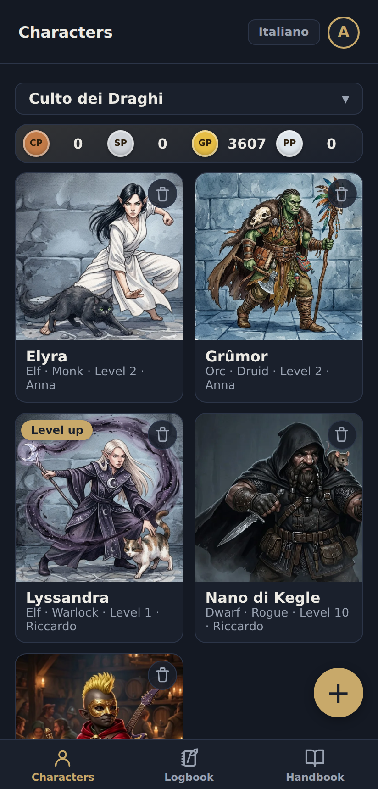
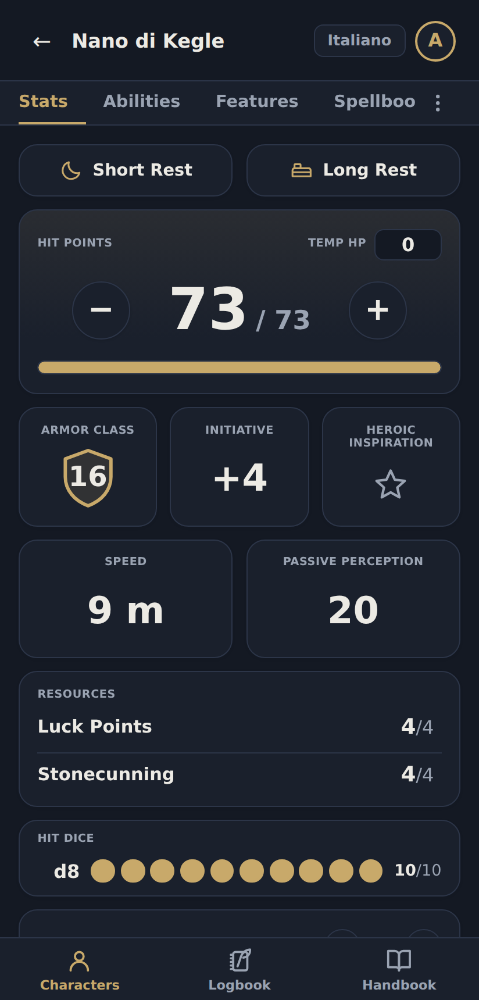
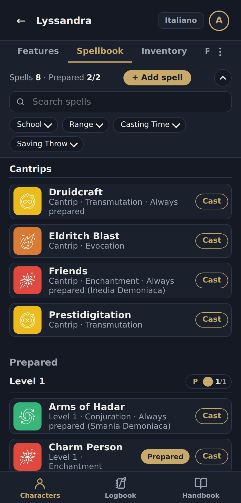
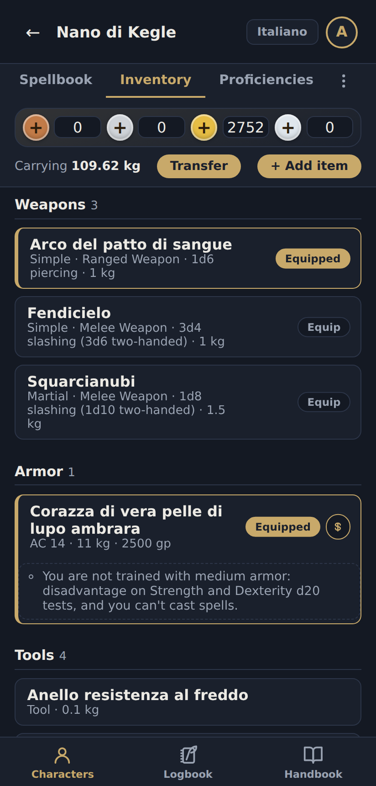
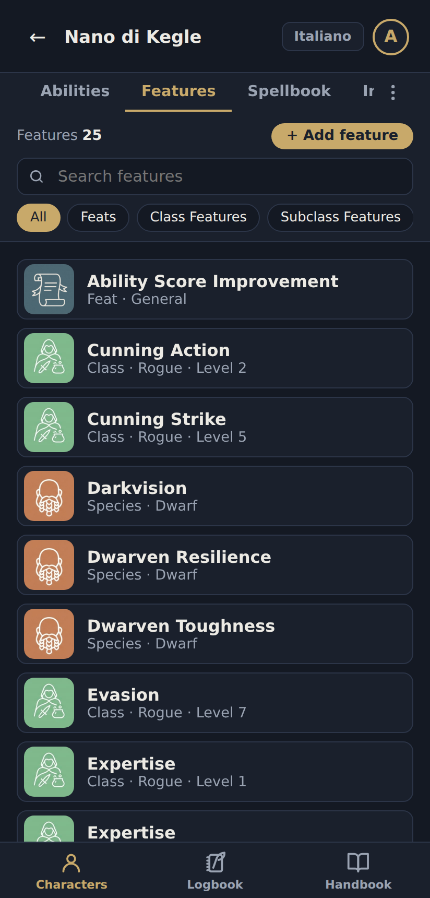
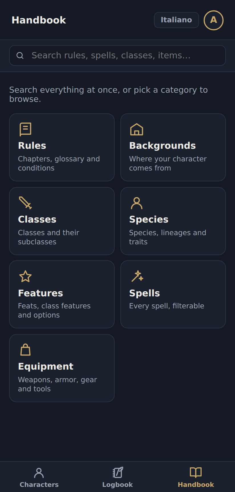

# La Compagna del Gobbo

**A mobile-first web app for playing Dungeons & Dragons 5.5e (the 2024 rules) at the table.**
Players build and level characters, run them during a session (HP, spell slots, rests, resources),
and keep a shared campaign logbook. A full rules handbook sits one tap away, in English and Italian.

It is a server-rendered Django application, installable as a PWA, built for a real group of players
who use it every session.

<p align="center">
  
  
  
  
</p>

## Features

- **Character builder and levelling** — a step-by-step wizard (class, species, background, abilities,
  equipment, spells) and a level-up flow that applies the 2024 rules: subclasses, feats, Ability
  Score Improvements, spell progression, class-table resources.
- **A sheet made for play** — hit points and temp HP, death saves, Hit Dice, spell slots, casting,
  prepared spells, conditions and exhaustion, class resources, inventory with equipping, coins.
  Short and long rests apply what the rules say (slot recovery, Arcane and Natural Recovery,
  Weapon Mastery swaps, prepared-spell changes...).
- **A rules handbook** — classes, species, backgrounds, feats, spells, equipment and the rules
  glossary, searchable and cross-linked (`{@spell ...}`-style references become real links).
- **Campaigns** — every character and logbook entry belongs to a campaign with one DM; members
  are invited, characters can be copied or transferred between campaigns.
- **Logbook** — a shared session diary with images, with automatic translation between English
  and Italian.
- **Bilingual** — the UI and the game content are available in English and Italian.
- **Installable PWA** — works like an app on a phone, with its own navigation history per tab.
- **AI assistant** — an optional rules chat with admin-managed LLM settings and a request log.

<p align="center">
  
  
</p>

## Tech stack

Python 3.12 · Django · PostgreSQL · uvicorn (ASGI) · WhiteNoise · django-modeltranslation ·
django-pwa · uv · Docker Compose · pytest · ruff. No JavaScript framework: pages are rendered on
the server and enhanced with small vanilla scripts.

## Architecture

```
rules       static 5.5e content (classes, species, spells, equipment...), imported from db/*.json
   │
characters  persisted characters and play state (HP, slots, inventory...), plus the rest/spend logic
   │
builder     creation and levelling engine
   │
frontend    server-rendered PWA UI           campaigns   who plays with whom
                                              ai          assistant chat
```

A few deliberate choices:

- **No public API.** The only HTTP surface is the HTML views (plus a few same-origin action
  endpoints used by the UI), which keeps the attack surface of an internet-facing app small.
- **No business logic in views.** Views call plain functions in `services/`, one file per domain.
- **`rules` is read-only** at runtime and loaded from the XPHB source data in `db/`.
- **Everything private is scoped by campaign**, with one module deciding who may see what.

The test suite covers the services and the rendered pages.

## Running it

```bash
cp .env.dist .env                      # set a password and a secret key
docker compose up -d --build           # app on http://localhost:3000
docker compose exec dnd-web uv run manage.py import_rules_data
```

For day-to-day development (Postgres in Docker, Django on the host):

```bash
docker compose up -d dnd-db
export POSTGRES_HOST=localhost POSTGRES_PORT=5462
uv run python manage.py migrate
uv run python manage.py import_rules_data
uv run uvicorn config.asgi:application --reload

POSTGRES_HOST=localhost POSTGRES_PORT=5462 uv run pytest   # tests
uv run ruff check .                                        # lint
```

## Documentation

- [docs/DEVELOPMENT.md](docs/DEVELOPMENT.md) — the detailed guide: run modes, conventions, every
  app and model, i18n, the character sheet's internals.
- [architecture.md](architecture.md) — the original design rationale.

## Credits

Game rules content is based on the D&D 5.5e System Reference Document (SRD 5.2) and the 5etools
XPHB data format. Dungeons & Dragons is a trademark of Wizards of the Coast; this is an unofficial
fan project, not affiliated with or endorsed by them.
